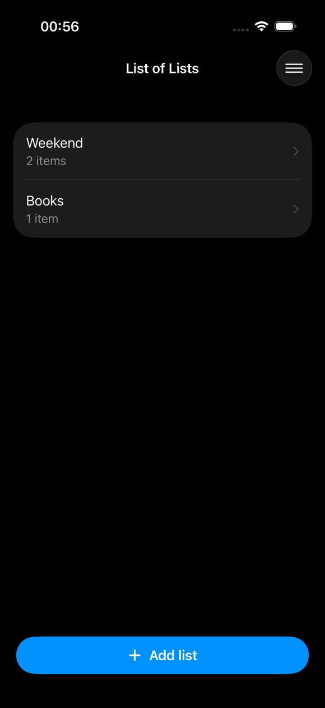
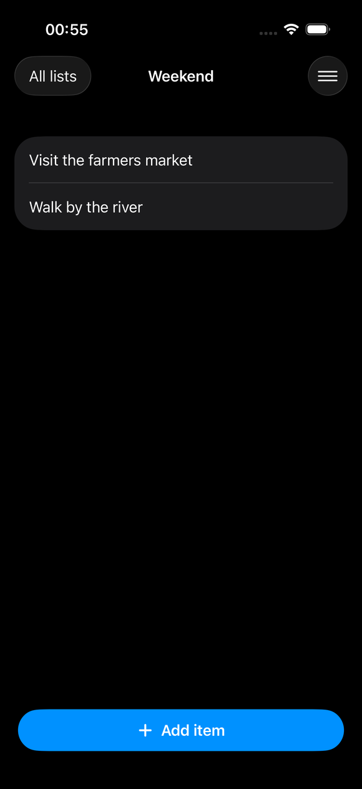

#  List of Lists

Make a list, tap it, and fill it with items. Each list gets its own swipeable page.

  
  

Start with **Add list**. Open the list and tap **Add item**. Tap an item to rename it or swipe left to delete it. Tap **All lists** to return to the directory. Swipe between pages, or open the top-right menu to jump directly to another list.

Lists and items are saved as JSON on your iPhone. The app works offline and starts empty.

## Run in Xcode

Clone the repository, open `ListOfLists.xcodeproj`, select the **ListOfLists** scheme and an iPhone simulator, and press **⌘R**. The project targets iOS 17 or later and uses only Apple frameworks. To run on your own iPhone, select your signing team and a unique bundle identifier in the app target.

Press **⌘U** to run the UI test. It creates two lists, adds different items to each, relaunches the app, and checks both lists again.
