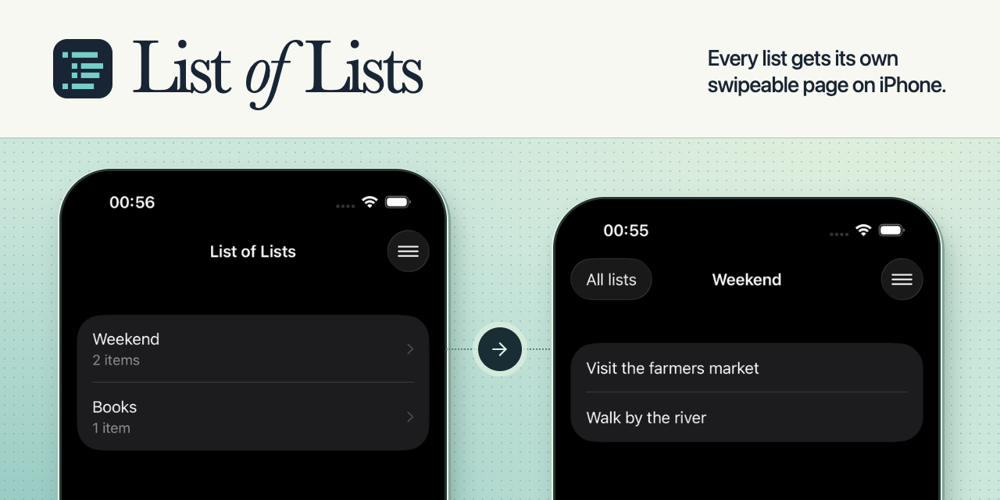

<h1 align="center">
   List of Lists
</h1>

<p align="center"><strong>List of Lists gives every list its own swipeable page on your iPhone.</strong></p>

<p align="center">
  <a href="https://github.com/calmmage/list-of-lists-ios"></a>
  
  
</p>

## Install on my iPhone

Connect your iPhone to a Mac with Xcode, then paste this into your coding agent.

```text
Install List of Lists directly on my iPhone.
Clone https://github.com/calmmage/list-of-lists-ios
Follow AGENTS.md and docs/install-iphone.md.

Build and sign the app on this Mac.
Install it on my connected iPhone.
Launch it and verify that it opens.
Guide me through sign-in or trust prompts.
```

[Step-by-step iPhone install](docs/install-iphone.md) · [Agent instructions](AGENTS.md)

<p align="center">
  <a href="docs/examples/hero.png"></a>
</p>
<p align="center"><a href="docs/examples/demo.mp4">Watch the 14-second demo</a></p>

## Make your first list

Tap **Add list**, name it, then open it and tap **Add item**. Tap an item to rename it or swipe left on its row to delete it.

Swipe across the space below the rows to turn the page. To jump to a list by name, open the menu in the upper right and search. Tap **All lists** to return to the directory and see how many items each list holds.

The app starts empty and works offline. Your iPhone saves the lists and their items together in a local JSON file.

## Run in Xcode

```sh
git clone https://github.com/calmmage/list-of-lists-ios.git
cd list-of-lists-ios
open ListOfLists.xcodeproj
```

Select the **ListOfLists** scheme. For a quick look, choose an iPhone simulator running iOS 17 or later and press **⌘R**. Press **⌘U** to run the UI test, which creates two lists and checks that each keeps its own items after relaunch.

For your own iPhone, select it as the run destination. In the **ListOfLists** app target, open **Signing & Capabilities**, select your team, and use a unique bundle identifier for your first install. Keep that identifier for updates. Press **⌘R** to install and launch. [Device setup and signing help](docs/install-iphone.md)
